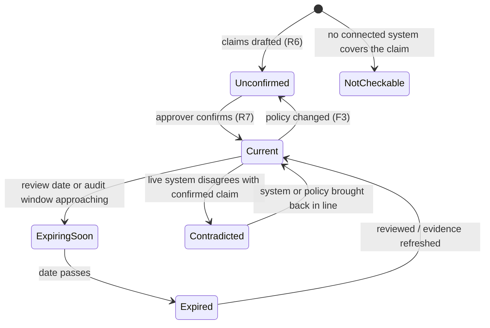

# Compliance Freshness Passport - Plan

## Goal Capsule

- **Objective:** Security leads and compliance consultants learn each week which SOC 2 and ISO 27001 policies and evidence have gone stale (contradicted by live systems, overdue for review, or outside the audit window) before an auditor finds it.
- **Product authority:** This Product Contract. Drafted fixes, configurable autonomy, and consultant workflow conveniences are later phases, not active scope.
- **Open blockers:** None block planning. Auditor acceptance of the export (R14) is an unvalidated assumption to test early; see Outstanding Questions.

---

## Product Contract

### Summary

A freshness passport for compliance material: every policy and evidence item carries a visible status (valid until when, last checked against live systems when, approved by whom), and a weekly report lists what expired or broke. An agent with read-only access checks what policies promise against how systems are actually configured, for SOC 2 and ISO 27001. In-house leads and consultants use the same product, with a consultant running one setup per client.

### Problem Frame

Teams preparing for SOC 2 or ISO 27001 audits accumulate stale material in three ways at once. Written policies drift from practice: a policy says MFA is enforced everywhere or access is reviewed quarterly, and the systems no longer match. Documents pass their required review or sign-off date without anyone noticing. Collected evidence ages out of the audit period.

These surface during the audit, when fixing them is most expensive and most visible. Existing evidence-collection tools pull live configuration well, but they do not check whether the written policies still describe reality. The pain is sharpest for a consultant, who meets this across every client, and for a solo in-house lead with no one else watching the paperwork.

The only demand signal so far is the observation that documents go stale; no one has yet been seen paying or building workarounds for this specific gap (see Dependencies / Assumptions).

### Actors

- A1. In-house security lead: owns compliance for one organization.
- A2. Compliance consultant: runs audit readiness for several client organizations, one setup per client.
- A3. Policy approver: a named person in the organization who confirms checkable claims and approves documents. May be the same person as A1, or a client contact for A2.
- A4. Freshness agent: reads policies and evidence, drafts checkable claims, checks them against live systems, and assigns statuses.
- A5. External auditor: consumes the passport export. Does not use the product directly in this version.

### Key Decisions

- **Freshness passport as the product shape.** Status and provenance on every item, with a weekly report of what changed, rather than a findings-only report. (session-settled: user-directed — chosen over a confirmed-claims ledger with a fast-start report, which was recommended: the user preferred building around auditor-visible freshness status from the start.) Governs R1, R2, R3, R13, R14.
- **Agent-drafted claims, human-confirmed trust.** The passport needs a detector underneath; the agent drafts checkable claims from each policy, and only a person's confirmation makes a resulting finding trusted. Governs R6, R7, R8.
- **Both personas carry equal weight.** (session-settled: user-directed — chosen over in-house-first and consultant-first: the user accepted a wider, slower first version to serve both.) Governs R15, R16.
- **SOC 2 and ISO 27001 from the start.** (session-settled: user-directed — chosen over SOC 2 only and framework-agnostic custom controls: the two frameworks cover what both personas see.) Governs R4.
- **Read-only system access for both personas.** The agent never changes system settings; this also bounds any future autonomy to documents, evidence refresh, and reminders. Governs R5.
- **Weekly report as the first deliverable.** (session-settled: user-approved — agent proposed the smallest valuable version as a weekly contradictions report, with drafting, autonomy settings, and cross-client consultant features held back; the user chose to start there.) Governs R11, R12.
- **All three staleness kinds are equal.** (session-settled: user-directed — chosen over prioritizing one of drift, overdue review, or aged evidence: they arrive together and fixing one alone does not help.) Governs R9.

### Requirements

**Freshness status**

- R1. Every policy document and evidence item in an organization shows a freshness status, the date it was last checked, and the named person who last approved it (or that it is unapproved).
- R2. A status distinguishes at least: current, expiring soon, expired (review date or audit window passed), contradicted by live systems, and not checkable (no system covers its claims).
- R3. Each status explains its cause in plain language, pointing to the specific claim, date, or system observation behind it.
- R4. Policies and evidence can be associated with SOC 2 and ISO 27001 controls, and the passport can be viewed per framework.

**Checking against reality**

- R5. The organization connects its systems with read-only access; the agent never writes to or changes connected systems.
- R6. When a policy is added or changed, the agent drafts a list of checkable claims from it (for example, "MFA is required on all production accounts").
- R7. An approver (A3) can confirm, edit, or reject each drafted claim.
- R8. Findings from confirmed claims are marked trusted; findings from unconfirmed claims are shown but marked unconfirmed and never presented as trusted.
- R9. The agent detects all three staleness kinds: a confirmed claim contradicted by live system state, a document past its review or sign-off date, and evidence collected outside the current audit window.
- R10. Checks run at least weekly without anyone triggering them.

**Weekly report**

- R11. Each week the organization receives a report listing items whose status changed to expiring soon, expired, contradicted, or not checkable since the last report.
- R12. A report with nothing to flag says so explicitly rather than being skipped.

**Auditor export**

- R13. The passport records, for each item, where and when its evidence was collected and whether each change or approval came from a person or the agent.
- R14. The passport can be exported for an auditor, showing each item's status, provenance (per R13), and approver.

**Personas**

- R15. A consultant (A2) can maintain separate setups for multiple client organizations under one login, with no data visible across clients.
- R16. Every capability in R1-R14 works the same way for an in-house lead's organization and for each of a consultant's client organizations.

### Key Flows

- F1. Organization setup
  - **Trigger:** A1 starts using the product, or A2 adds a new client.
  - **Actors:** A1 or A2, A3, A4
  - **Steps:** Connect systems read-only; upload or link policies and existing evidence; associate them with SOC 2 and ISO 27001 controls; the agent drafts claims; the approver confirms, edits, or rejects them; the first passport and report are produced.
  - **Outcome:** Every item has a status; unconfirmed claims are visible as such.
  - **Covered by:** R4, R5, R6, R7, R8, R15
- F2. Weekly freshness check
  - **Trigger:** The weekly schedule.
  - **Actors:** A4, then A1 or A2
  - **Steps:** The agent re-checks confirmed claims against live systems, checks review dates and audit windows, updates statuses, and sends the report.
  - **Outcome:** The user sees what broke or expired this week and why.
  - **Covered by:** R1, R2, R3, R9, R10, R11, R12
- F3. Policy change
  - **Trigger:** A policy document is edited or replaced.
  - **Actors:** A4, A3
  - **Steps:** The agent drafts updated claims; findings from changed claims stay unconfirmed until the approver acts.
  - **Covered by:** R6, R7, R8
- F4. Auditor export
  - **Trigger:** A1 or A2 prepares for an audit.
  - **Actors:** A1 or A2, A5
  - **Steps:** Export the passport for the chosen framework and hand it to the auditor.
  - **Covered by:** R13, R14

The diagram shows the main transitions; R2 owns the status set, and the lifecycle is illustrative rather than exhaustive.

### Acceptance Examples

- AE1. Contradicted confirmed claim. **Covers R8, R9, R11.**
  - **Given** an approver confirmed "MFA is required on all production accounts" and one production account has MFA off,
  - **When** the weekly check runs,
  - **Then** the policy shows contradicted and trusted, names the account, and appears in that week's report.
- AE2. Same contradiction, unconfirmed claim. **Covers R8.**
  - **Given** the same claim was drafted but never confirmed,
  - **When** the check finds the same gap,
  - **Then** the finding appears marked unconfirmed, not trusted.
- AE3. Evidence ages out. **Covers R9, R11.**
  - **Given** an access-review export was collected before the current audit window began,
  - **When** the weekly check runs,
  - **Then** the evidence shows expired, and the report lists it with the window dates.
- AE4. Quiet week. **Covers R12.**
  - **Given** no status changed since the last report,
  - **When** the weekly report is due,
  - **Then** the user receives a report stating nothing changed.
- AE5. Consultant isolation. **Covers R15.**
  - **Given** a consultant has clients X and Y,
  - **When** they view or export client X's passport,
  - **Then** nothing from client Y appears.

### Scope Boundaries

**Deferred for later**

- Agent-drafted fixes: updated policy text, fresh evidence requests, reminders to owners.
- Configurable autonomy per action type, from flag-only to fully autonomous, set during setup. Read-only access (R5) limits even full autonomy to documents, evidence refresh, and reminders.
- Consultant workflow conveniences: cross-client overview, sending evidence requests to clients, reusable templates across clients.
- Frameworks beyond SOC 2 and ISO 27001, and user-defined custom controls.

**Outside this product's identity**

- Changing system configuration to fix drift; the product observes, it does not remediate infrastructure.
- Replacing a full evidence-collection compliance platform; the passport's job is freshness and truthfulness of what exists, not exhaustive evidence gathering.
- Acting as or replacing the auditor; the export supports an audit and does not certify compliance.

### Dependencies / Assumptions

- Both personas can grant the agent read-only access to the relevant systems, including consultants for their clients. Unvalidated; stated by the user as a working assumption.
- Demand for freshness checking is assumed from the observation that documents go stale; no workaround or spending has been observed yet.
- What auditors need before they accept agent-gathered evidence and agent-drafted claims is unknown. R13 and R14 are provisional until one or two auditors have reviewed a sample export.

### Outstanding Questions

**Resolve Before Planning**

- None.

**Deferred to Planning**

- Which systems to connect first (cloud, identity, HR, code hosting, ticketing) to cover the most common SOC 2 and ISO 27001 claims.
- How "expiring soon" is defined: a fixed lead time or one set per organization.
- How the weekly report is delivered (email, in-product, or both).
- How the agent handles policy claims that no connected system can verify beyond marking them not checkable (R2).
- Export format for R14, pending the auditor conversations above.
